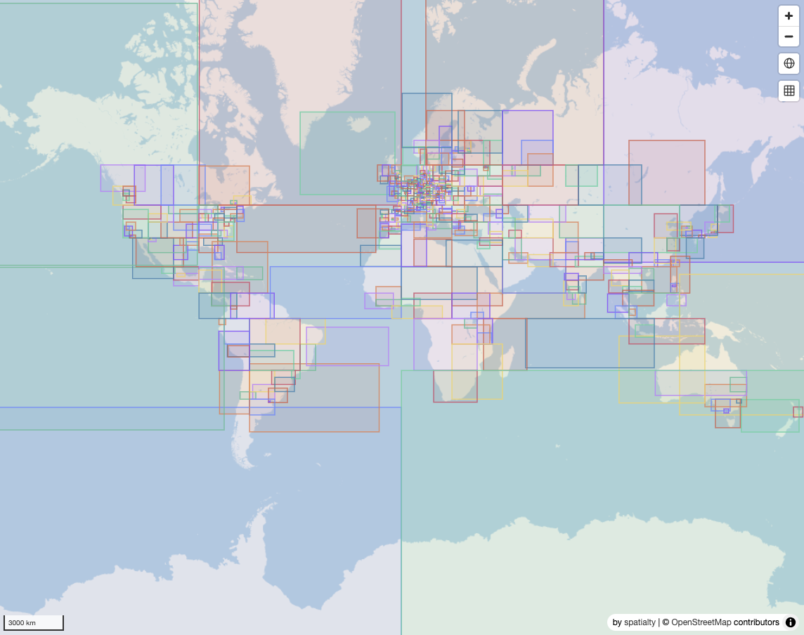
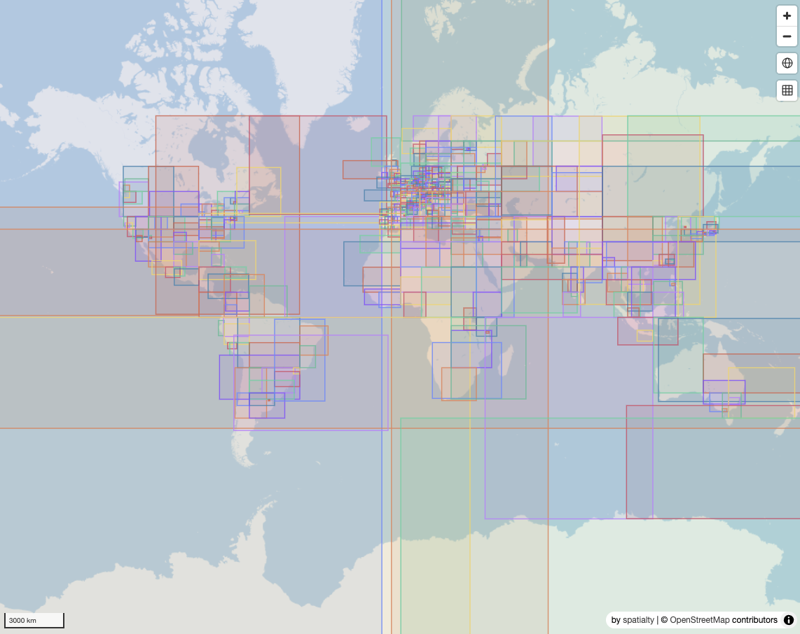
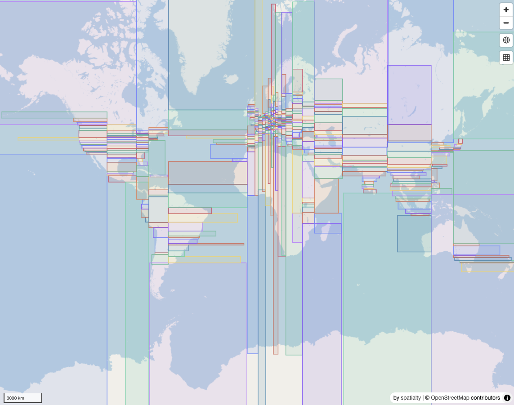
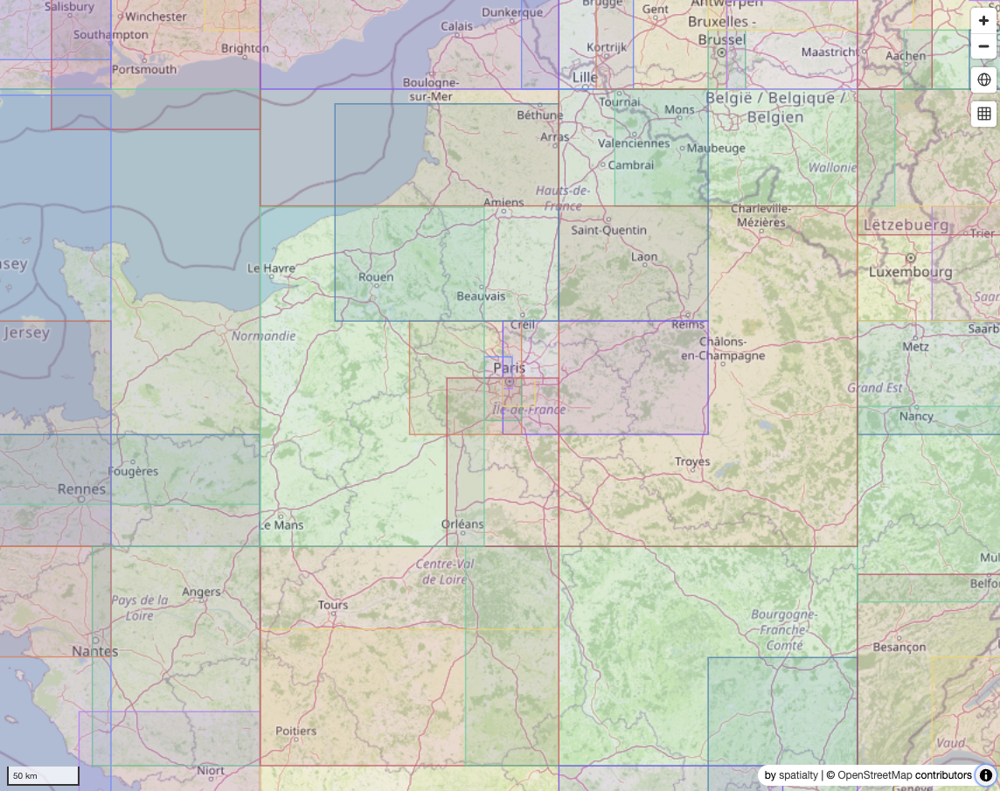
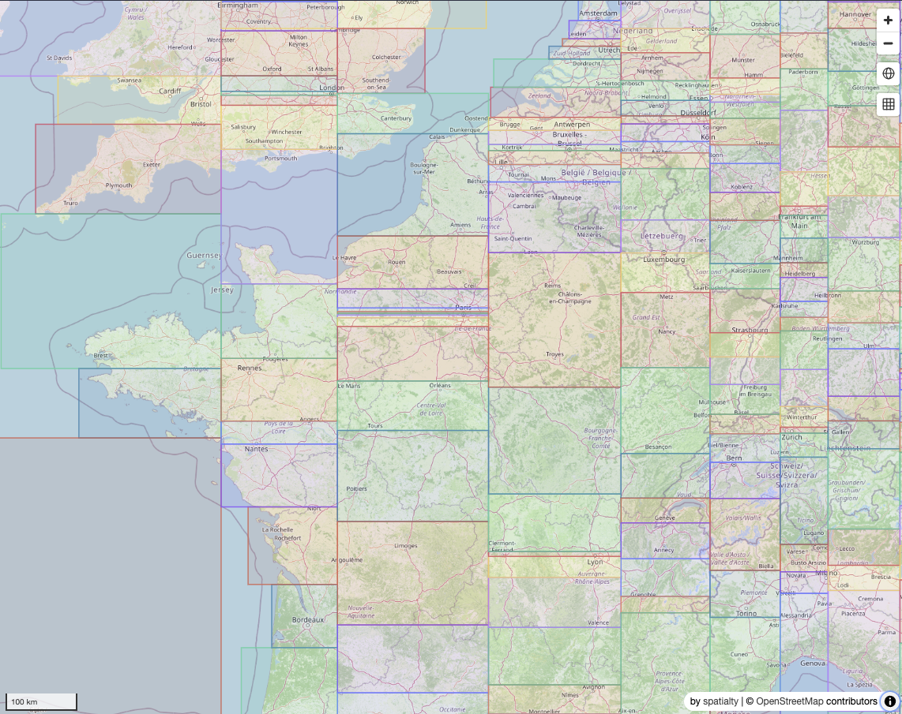

# Comparing spatial sort algorithms for well packed GeoParquet

This repository contains a comparison of spatial sort algorithms for well packed GeoParquet files. The algorithms compared are:

- Hilbert curve
- Morton curve
- Sort-Tile-Recursive
- Boost.Geometry-style R-tree Packing

## Data

- [pois](https://cogp-demo.spatialty.io/pois.cogp.parquet) (OpenStreetMap)

## Conditions

- Row group size: 50,000 requested (`COPY ... ROW_GROUP_SIZE 50000`);
  DuckDB 1.5.5 writes 51,200 rows per full group
- Compression: ZSTD
- Output file format: GeoParquet v1.1

## Criteria

The algorithms are compared based on the following criteria:
- Sorting time
- Query performance
- File size
- Spatial locality (measured by how small overlap the bounding boxes of each row group are)

## Notes

- Hilbert uses DuckDB spatial's `ST_Hilbert` over the CRS84 world extent.
- Morton uses DuckDB spatial's `ST_QuadKey` at level 23. With a fixed level,
  lexicographic quadkey ordering is Z-order/Morton ordering over the Web
  Mercator tile grid.
- STR pack sorts by bbox center-x, splits rows into approximately square
  strips containing whole Parquet row groups, then sorts each strip by center-y
  with alternating direction. The strip width uses DuckDB's measured row group
  width, so a written row group cannot straddle two strips.
- Boost-style pack follows the node-capacity and recursive median-split rules in
  [Boost.Geometry's packing implementation](https://github.com/boostorg/geometry/blob/develop/include/boost/geometry/index/detail/rtree/pack_create.hpp):
  choose the longer side of the current hint box, split bbox centers at the
  capacity-aware median, and recurse until each leaf fits the target size.
  DuckDB window queries perform the splits; the benchmark does not require
  Boost or a C++ compiler. Equal center coordinates use source row number as a
  deterministic tie-breaker, so tied rows need not match Boost's exact order.
  A small Parquet write measures DuckDB's actual row group width and uses that
  width as the packing node capacity, keeping leaf boundaries aligned.

To build and benchmark all four algorithms on a local input file:

```bash
uv run python scripts/compare_spatial_sort.py all \
  --input pois.cogp.parquet \
  --metrics-dir metrics/rg50000-fair-20261013 \
  --row-group-size 50000 \
  --threads 8 \
  --memory-limit 16GB \
  --force
```

Use `--algorithms boost_pack` to run only Boost-style packing. Its build time
includes the iterative DuckDB partitioning and final Parquet write.

## Results

Full local benchmark run on 2026-10-13 using DuckDB 1.5.5, 30,052,264 POIs,
`ROW_GROUP_SIZE 50000`, ZSTD, 8 threads, and a 16GB DuckDB memory limit. Every
output has 587 row groups. The generated CSV files are in
`metrics/rg50000-fair-20261013/` (ignored by Git).

An earlier STR run reported an overlap ratio of 0.090 because its x-strip
boundaries fell inside written row groups. DuckDB writes 51,200 rows per full
group for the requested 50,000, and the earlier STR strip width was not a
multiple of either size. The current STR implementation uses whole written
row groups per strip. Both STR and Boost-style packing now use the measured
51,200-row leaf width.

### Build and size

| Algorithm | Build time (s) | File size (GiB) | Rows | Row groups |
| --- | ---: | ---: | ---: | ---: |
| Hilbert | 8.5 | 1.826 | 30,052,264 | 587 |
| Morton (`ST_QuadKey`) | 9.6 | 1.837 | 30,052,264 | 587 |
| STR pack | 16.4 | 1.830 | 30,052,264 | 587 |
| Boost-style pack | 28.9 | 1.839 | 30,052,264 | 587 |

### Spatial locality

Lower values are better. `sum_area` is the sum of row group bbox areas, and
`overlap_area_ratio` is pairwise overlap area divided by `sum_area`.

| Algorithm | Sum area | Median area | Pairwise overlap area | Overlap area ratio |
| --- | ---: | ---: | ---: | ---: |
| Hilbert | 76,868.4 | 5.217 | 21,870.7 | 0.285 |
| Morton (`ST_QuadKey`) | 167,793.5 | 8.223 | 202,075.2 | 1.204 |
| STR pack | **51,200.6** | **4.424** | **0.0** | **0.000** |
| Boost-style pack | 52,701.5 | 5.204 | **0.0** | **0.000** |

### Local query performance

The six bbox queries below were interleaved across algorithms with 3 warmups
and 30 measured repeats. Median elapsed time in milliseconds:

| Algorithm | Tokyo | SF Bay | New York | London | Paris | Singapore |
| --- | ---: | ---: | ---: | ---: | ---: | ---: |
| Hilbert | 9.15 | 6.09 | 6.60 | 7.20 | 7.44 | 8.18 |
| Morton (`ST_QuadKey`) | 9.30 | 6.11 | 7.02 | 7.70 | 8.95 | 8.09 |
| STR pack | 8.13 | 6.02 | 6.53 | 6.85 | 7.04 | 8.04 |
| Boost-style pack | 8.12 | 6.09 | 6.61 | 6.96 | 7.24 | 7.87 |

Candidate row groups by bbox column statistics:

| Algorithm | Tokyo | SF Bay | New York | London | Paris | Singapore |
| --- | ---: | ---: | ---: | ---: | ---: | ---: |
| Hilbert | 11 | 5 | 6 | 8 | 7 | 3 |
| Morton (`ST_QuadKey`) | 11 | 6 | 8 | 10 | 12 | 4 |
| STR pack | 7 | 3 | 4 | 5 | 6 | 2 |
| Boost-style pack | 6 | 3 | 5 | 5 | 7 | 2 |

Both STR and Boost-style packing have zero pairwise row group bbox overlap on
this point dataset. STR has the smaller total bbox area and shorter build time
in this run. Their local query medians are close. These local times should not
be compared directly with the remote results below.

#### Historical row group bbox images

These images show the earlier STR output whose strips were not aligned to
Parquet row groups. They do not illustrate the corrected results above.

| Hilbert | Morton (`ST_QuadKey`) | STR pack |
| --- | --- | --- |
|  |  |  |

Additional views:

| Hilbert | STR pack |
| --- | --- |
|  |  |

### Remote query performance

Query benchmarks target remote Parquet files. Remote benchmarks disable
DuckDB external file, HTTP metadata, Parquet metadata, and caching-operator
caches, and use a fresh DuckDB connection for each measured query. Connection
creation and extension loading are outside the timed section. Warmups are
disabled for remote runs.

Query bboxes:

| Query | xmin | ymin | xmax | ymax |
| --- | ---: | ---: | ---: | ---: |
| Tokyo | 139.55 | 35.50 | 139.95 | 35.85 |
| SF Bay | -122.65 | 37.55 | -121.75 | 38.05 |
| New York | -74.30 | 40.45 | -73.65 | 40.95 |
| London | -0.55 | 51.25 | 0.35 | 51.75 |
| Paris | 2.20 | 48.75 | 2.45 | 48.95 |
| Singapore | 103.60 | 1.20 | 104.05 | 1.50 |

Remote benchmark run on 2026-10-13 with 30 measured repeats, no warmups, and
interleaved algorithms. The STR and Boost files were uploaded to
`cogp/bench/` after the row group alignment fix; the existing Hilbert and
Morton files were retained. The generated CSV files are in
`metrics/remote-fair-20261013/` (ignored by Git). Median bbox query time in
milliseconds:

| Algorithm | Tokyo | SF Bay | New York | London | Paris | Singapore |
| --- | ---: | ---: | ---: | ---: | ---: | ---: |
| Hilbert | 1,379.04 | 1,005.10 | 1,080.83 | 1,164.90 | 1,100.93 | 966.37 |
| Morton (`ST_QuadKey`) | 1,382.73 | 1,082.80 | 1,135.17 | 1,359.26 | 1,436.61 | 983.42 |
| STR pack | 1,050.94 | 939.48 | 944.95 | 975.44 | 1,035.58 | 929.97 |
| Boost-style pack | 1,053.83 | 936.70 | 995.14 | 974.83 | 1,096.29 | 939.71 |

Candidate row groups by bbox column statistics. Total row groups: 587.

| Algorithm | Tokyo | SF Bay | New York | London | Paris | Singapore |
| --- | ---: | ---: | ---: | ---: | ---: | ---: |
| Hilbert | 11 | 5 | 6 | 8 | 7 | 3 |
| Morton (`ST_QuadKey`) | 11 | 6 | 8 | 10 | 12 | 4 |
| STR pack | 7 | 3 | 4 | 5 | 6 | 2 |
| Boost-style pack | 6 | 3 | 5 | 5 | 7 | 2 |

STR and Boost-style packing are close on these remote queries. This run does
not establish a consistent latency advantage for either packing algorithm.

```bash
uv run python scripts/compare_spatial_sort.py bench \
  --bench-output-base https://cogp-demo.spatialty.io/bench \
  --algorithms hilbert,morton,str,boost_pack \
  --skip-locality \
  --query-repeats 30 \
  --query-warmups 0 \
  --query-seed 42 \
  --threads 8 \
  --memory-limit 16GB \
  --metrics-dir metrics/remote-fair-20261013
```
